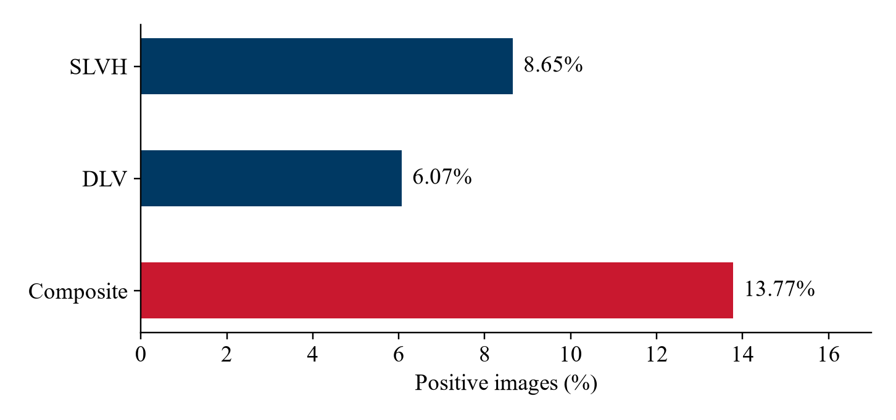
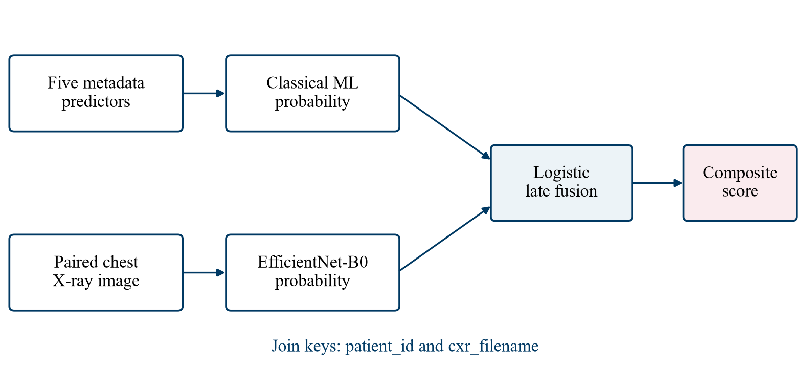
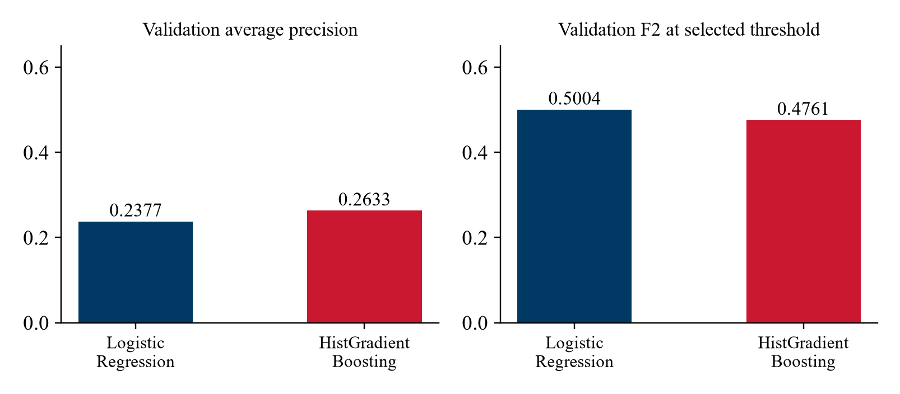
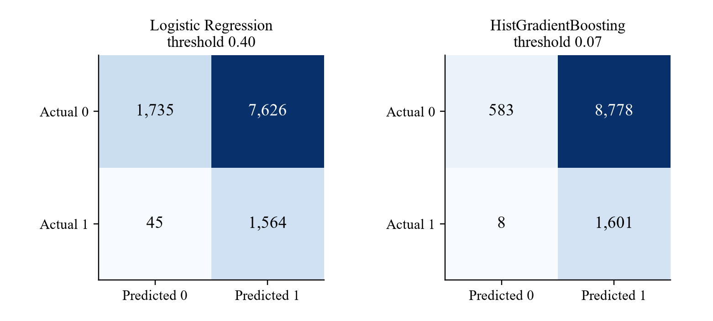
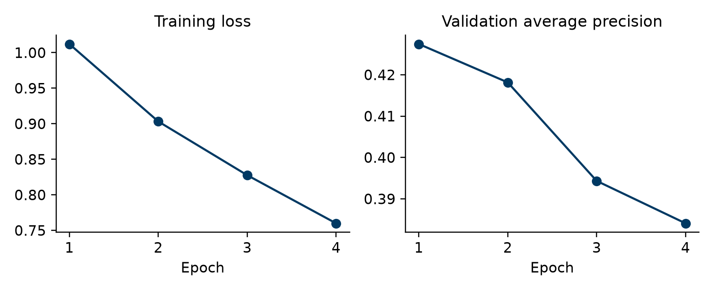
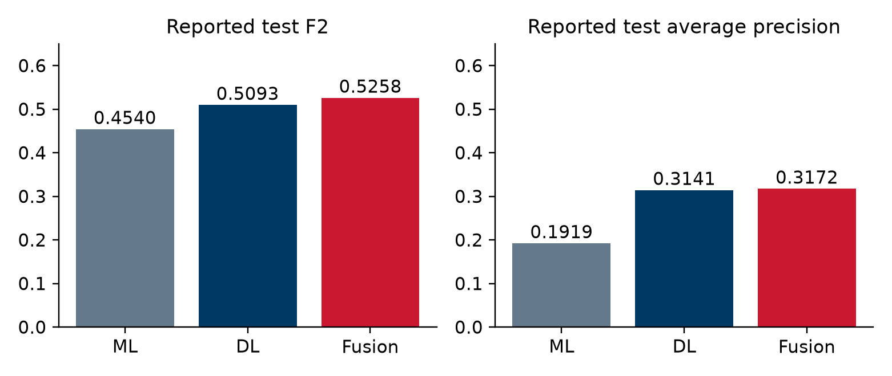

# Cardiac structure screening from chest X rays

Based on Machine learning and deep learning

Group N17 · Members 202414865, 202414821, 202414845

The current evidence includes the historical metadata validation run and the three-model Colab test export imported on 1 November 2026. The supplied aggregate exports are included unchanged in results/.

## 1 Introduction

### 1.1 Motivation

This project develops a screening pipeline that combines patient metadata with a chest X-ray to estimate the presence of severe left ventricular hypertrophy or a dilated left ventricle. We use the composite SLVH/DLV label in CheXchoNet as the prediction target. The intended research question is whether a small metadata model can add useful information to an image model for the same examination.

The study by Bhave et al. provides the direct clinical and technical basis for this task. It evaluates structural cardiac findings on radiographs using echocardiographic labels and reports external validation [2]. We use its task definition as background. Its published performance does not represent the performance of our implementation.

Our evidence now includes a local data audit, two metadata validation baselines and the Colab exports for ML, DL and late fusion. On the reported test comparison, fusion gives F2 0.5258 versus 0.5093 for EfficientNet-B0 alone. Recall increases from 70.25% to 77.27%, while precision decreases from 24.25% to 23.09%. This is an observed operating-point tradeoff, not evidence of statistical significance or clinical benefit.

### 1.2 Objectives

The main objective is to construct a reproducible pipeline with one metadata branch and one image branch, then compare their separate predictions with a combined prediction. Each probability must refer to the same patient and the same chest X-ray filename.

The specific objectives are to preserve patient separation between data partitions, exclude measurements that directly define the target, establish metadata baselines, configure EfficientNet-B0 for the image task, and assess whether late fusion improves a clinically useful operating point. Evaluation must report false positives as well as sensitivity.

### 1.3 Scope

The prediction unit is an X-ray examination. The metadata branch uses age, sex and transplant or implanted-device indicators. This release does not provide a complete laboratory panel. The model output is a score for the composite structural abnormality, followed by a threshold-based screening flag. A validated clinical decision would still require assessment by a healthcare professional.

The earlier 70,000-row cardiovascular tabular dataset and CheXchoNet contain different records and targets. We do not concatenate their rows or pair their patients. All training and validation evidence in this report comes from CheXchoNet.

## 2 Project implementation

### 2.1 User requirements

A research user should be able to load the dataset, verify the image links, reproduce the patient split and run the two model branches in Google Colab. The pipeline should return the metadata score, image score and fused score for an aligned examination. A missing or duplicated pairing must stop the fusion step rather than silently changing the sample.

Table 1  Project requirements

| Requirement | Implementation or acceptance condition |
| --- | --- |
| Correct pairing | Use patient_id and cxr_filename as a joint key. |
| Patient separation | No patient appears in more than one partition. |
| Leakage control | IVSD, LVPWD, LVIDD and all target columns are absent from predictors. |
| Reproducibility | Save the split manifest, model parameters, thresholds and validation records. |
| Transparent comparison | Report metadata ML, image DL and fusion on the same final test set. |
| Interpretation | Show screening scores with false-positive and false-negative analysis. |

### 2.2 Specifications

#### 2.2.1 Functionalities

The notebook discovers a dataset folder or a complete archive, reads metadata.csv and resolves each image using cxr_filename. Data preparation validates demographic and target fields before creating the five metadata predictors. Model code fits two classical ML candidates, trains a binary image classifier and joins branch probabilities for logistic fusion.

The final evaluation routine is designed to save model objects, image weights, training history, selected thresholds and examination-level predictions. It also produces a confusion matrix and a probability calibration plot. Grad-CAM and subgroup analyses are future additions; the current notebook does not yet implement them.

#### 2.2.2 Non functional requirements

The project must remain runnable within a Colab GPU session. A 224 by 224 image input and EfficientNet-B0 limit the memory requirement. The archive should be extracted to temporary Colab storage where possible, while persistent outputs go to Google Drive. An interrupted session should not erase the original dataset.

Every reported measurement must identify its partition and analysis unit. Current validation metrics are image-level estimates from repeated examinations within patients. They do not provide patient-level confidence intervals. Access to source data must remain within the terms accepted for the PhysioNet resource.

#### 2.2.3 Dataset specification

CheXchoNet v1.0.0 pairs PA chest radiographs with echocardiographic information from the same patients. The source cohort links examinations within a 12-month window and releases processed JPEG images [1]. The local audit found 71,589 image records from 24,689 patients, with ages from 18 to 90. There are 37,289 female and 34,300 male image records; these are examination counts rather than unique-patient sex counts.

The target composite_slvh_dlv equals one when either component label is positive. Our audit found 6,191 SLVH-positive images, 4,343 DLV-positive images and 9,861 composite-positive images. Every composite value agrees with the logical OR of the supplied component labels.

Figure 1  Composite label and component prevalence

Table 2  Metadata roles and target leakage control

| Field group | Use in this project |
| --- | --- |
| patient_id and cxr_filename | Identifiers for partitioning, image lookup and probability alignment. Not predictors. |
| age and sex | Create age_scaled = (age - 18) / 72 and sex_binary (F = 0, M = 1). |
| heart_transplant, lung_transplant, pacemaker_or_icd | Binary metadata predictors retained by the approved feature list. |
| ivsd, lvpwd and lvidd | Excluded from model inputs because they define the supplied targets. |
| slvh, dlv and composite_slvh_dlv | Outcome labels only. The current classifier predicts the composite. |
| Timing, paths and pixel spacing | Retained as metadata but excluded from the five-feature ML model. |

#### 2.2.4 Data preparation and patient split

We retain adult records with a valid image filename, a recognized sex value and binary labels. The prepared local manifest has no missing values in the five selected source features. Median imputation remains inside the ML pipeline so later data are handled consistently, with imputation values learned from training data only.

Patients receive a single train, validation or test assignment. The split uses seed 42 and stratifies patient groups by whether any examination has a positive composite label. We then map each patient's assignment back to all their images. This prevents repeated examinations from the same patient crossing partitions, although image-level prevalence need not be identical across them.

Table 3  Patient split and label prevalence

| Partition | Images | Patients | Positive | Prevalence |
| --- | --- | --- | --- | --- |
| Train | 50,233 | 17,282 | 6,840 | 13.62% |
| Validation | 10,970 | 3,703 | 1,609 | 14.67% |
| Test | 10,386 | 3,704 | 1,412 | 13.60% |
| Total | 71,589 | 24,689 | 9,861 | 13.77% |

All 71,589 referenced image files exist locally. The manifest contains zero duplicate patient-and-filename keys and zero patients assigned to multiple partitions. The Colab export now provides a three-model test comparison. The exported aggregate files do not include predictions or a run-specific manifest hash, so they cannot independently establish the exact evaluated record set.

### 2.3 Planning

The project follows the course workflow from problem definition to reporting. Week 6 fixed the model design and Week 7 established metadata baselines. The current Colab exports add image training and a three-model test comparison. Remaining work concerns validation quality, uncertainty and case-level review.

Table 4  Project workflow and current evidence

| Stage | Weeks | Evidence or remaining work |
| --- | --- | --- |
| Problem definition and review | 1–2 | Composite cardiac-structure screening task and relevant literature. |
| Data collection and review | 2–3 | Downloaded CheXchoNet release and metadata dictionary. |
| Preprocessing and review | 3–5 | Patient split, feature restrictions and image transforms. |
| Model selection and review | 5–7 | ML candidates and EfficientNet-B0 configuration; validation baselines measured. |
| Model training | 7–10 | Metadata baseline and Colab image/fusion results available. |
| Evaluation | 10–12 | Aggregate test comparison available; confidence intervals and case-level review remain. |
| Reporting | 12–15 | Report structure and weekly slides maintained with available evidence. |

The N17 team consists of Student 1 (202414865), Student 2 (202414821) and Student 3 (202414845).

### 2.4 Block design

Figure 2  Metadata and image probability fusion

The metadata branch receives the five approved predictors and returns ml_probability. The image branch receives the corresponding radiograph and returns dl_probability after a sigmoid transformation of its single output logit. A logistic regression model takes these two probabilities and returns a composite screening score.

Before fusion, the alignment function compares the full sets of joint identifiers and performs a one-to-one join. It raises an error for duplicate keys or mismatched examinations. Row order alone never determines the pairing. This matters because data loaders and DataFrame transformations can change record order.

The final score must be associated with the saved decision threshold. At inference time, a user supplies the metadata and image from the same examination. The pipeline applies saved preprocessing, obtains both branch scores and applies fusion. A deployed input form or clinical interface has not yet been built.

### 2.5 Best alternative selection

Table 5  Model alternatives

| Alternative | Reason for inclusion | Current evidence |
| --- | --- | --- |
| Logistic Regression | Interpretable baseline for a small feature set. | Trained; higher validation ROC-AUC and F2 of the two ML candidates. |
| HGB classifier | Can model nonlinear feature relationships. | Trained; highest validation average precision. |
| EfficientNet-B0 | Transfer learning with a relatively compact image backbone [3,5]. | Colab test results: AP 0.3141 and F2 0.5093. |
| Logistic late fusion | Combines branch evidence through two probability inputs. | Colab test results: AP 0.3172 and F2 0.5258. |

The current notebook chooses HistGradientBoosting because the selection rule ranks validation average precision. This is a metric-specific choice. Logistic Regression is stronger on validation ROC-AUC and F2, so the selected model should not be described as uniformly superior. Both models remain useful baselines for the later image and fusion comparison.

### 2.6 Detailed model specifications

#### 2.6.1 Metadata models

Logistic Regression uses a median imputer, StandardScaler, balanced class weights, a maximum of 2,000 iterations and seed 42. HistGradientBoosting uses a median imputer without scaling, learning rate 0.05, at most 250 boosting iterations and L2 regularization 1.0. Its fitting call receives balanced sample weights computed from the training labels.

The two pipelines train on 50,233 records and produce scores for the same 10,970 validation images. Each model searches 181 thresholds from 0.05 to 0.95 in increments of 0.005. The threshold with the largest validation F2 is retained. Ties follow the notebook's first-encountered threshold rule.

#### 2.6.2 Image model and preprocessing

EfficientNet-B0 starts from torchvision's ImageNet weights. The code replaces the last classifier layer with one output and fine-tunes the network. Each grayscale radiograph is converted to three channels before tensor conversion and channel normalization. The same normalization statistics apply in every partition [5].

Training transforms resize to 256 pixels, apply RandomResizedCrop to 224 by 224 with a scale range of 0.85 to 1.0, rotate by up to five degrees and make mild brightness or contrast changes of 0.10. Validation and test transforms use deterministic resizing and center cropping. These operations are specified in the notebook; their effect on diagnostic image content still requires visual checking during the GPU run.

Table 6  Training configuration

| Parameter | Current notebook value |
| --- | --- |
| Image size and batch size | 224 × 224 pixels; batch size 32 |
| Optimizer | AdamW; learning rate 0.0001; weight decay 0.0001 |
| Maximum duration | 10 epochs; early stopping patience 3 |
| Loss | BCEWithLogitsLoss; training positive weight 6.3440 |
| Checkpoint selection | Maximum validation average precision |
| Data loader | Two workers; training shuffle only |
| Acceleration | CUDA when available; automatic mixed precision enabled on CUDA |

The positive weight equals the training negative count divided by the training positive count: 43,393 divided by 6,840. Validation and test data retain their observed prevalence. Class weighting changes the training objective; it does not establish that a sigmoid output is a calibrated disease probability.

#### 2.6.3 Fusion and threshold selection

The implemented fusion pipeline scales ml_probability and dl_probability, then fits balanced Logistic Regression with a maximum of 1,000 iterations and seed 42. The current notebook fits fusion on validation predictions and selects its F2 threshold using those same observations.

That procedure leaves the test set untouched, but its fusion validation score is optimistic because it reuses data for fitting and threshold selection. Before interpreting fusion validation as evidence of improvement, the next experiment should reserve a separate patient-level subset for fusion tuning or use out-of-fold branch predictions. This refinement is recommended here and is not claimed to be implemented in the current notebook.

### 2.7 Prototyping and execution

The prototype is a Colab notebook with supporting data utilities. The cell sequence covers package checks, drive mounting, data discovery, metadata validation, partitioning, ML comparison, image training and fusion evaluation. The utilities in chexchonet_pipeline_ml_support_dl.py make pairing and split logic independently testable.

For Colab, the complete archive or extracted data belongs under MyDrive/Hoc_may_2_0/DL_Xray/CheXchoNet. The notebook extracts an archive to /content/chexchonet_cache and saves persistent outputs under outputs_ml_support_dl. A GPU runtime is required for a practical full image-training experiment. The task must be restarted from saved files if the temporary runtime disconnects.

The Week 7 metadata run executed the existing notebook's ML comparison against the saved manifest. It used Python 3.12.10 and scikit-learn 1.6.1. The run saved the fitted metadata model, validation predictions, model-selection table and a receipt containing the notebook and manifest hashes. Test probabilities may be generated by the copied notebook cell, but no test metrics were computed.

### 2.8 Testing and results

#### 2.8.1 Data integrity

Table 7  Data integrity checks

| Check | Measured result |
| --- | --- |
| Metadata rows versus image files | 71,589 rows and 71,589 files |
| Missing referenced images | 0 |
| Duplicate patient_id and cxr_filename keys | 0 |
| Patients crossing partitions | 0 |
| Composite label disagreement with SLVH OR DLV | 0 |
| Missing values in the five source metadata fields | 0 for each field |
| Age validity | All retained ages lie between 18 and 90 |

These checks establish local file consistency and partition separation. They do not prove that the labels are free of measurement error or that an image taken months from its echocardiogram reflects the same disease state.

#### 2.8.2 Metadata validation results

The following measurements use the validation partition only: 10,970 images from 3,703 patients, including 1,609 positive images. The report uses the notebook's term PR-AUC for average precision (AP), as computed by average_precision_score. AP is not the same numerical estimator as trapezoidal integration of a precision–recall curve [4].

Table 8  Metadata validation metrics

| Model | AP | ROC-AUC | F2 | Threshold |
| --- | --- | --- | --- | --- |
| Logistic Regression | 0.2377 | 0.6476 | 0.5004 | 0.40 |
| HistGradientBoosting | 0.2633 | 0.6149 | 0.4761 | 0.07 |

Figure 3  Metadata model validation comparison

HistGradientBoosting ranks higher by AP, which measures its ranking of positive examinations across recall levels. Logistic Regression has a higher F2 at the selected operating point. The difference shows why selecting a probability-ranking model and selecting a screening threshold are separate decisions.

At threshold 0.07, HistGradientBoosting recalls 99.50% of validation positives, but precision is 15.43% and specificity is 6.23%. It flags 10,379 of 10,970 images, or 94.61% of the validation set. Logistic Regression at threshold 0.40 recalls 97.20%, with precision 17.02% and specificity 18.53%. These operating points would create a large review burden.

Table 9  Validation decision counts

| Model | TN | FP | FN | TP |
| --- | --- | --- | --- | --- |
| Logistic Regression | 1,735 | 7,626 | 45 | 1,564 |
| HistGradientBoosting | 583 | 8,778 | 8 | 1,601 |

Figure 4  Validation confusion matrices

F2 emphasizes recall, but it does not impose a minimum precision or specificity. The threshold search can therefore favor predicting positive for nearly everyone when metadata discrimination is limited. A future clinical operating-point analysis should add an explicit workload or specificity constraint, then compare the image and fusion models at that same constraint.

#### 2.8.3 Colab image and fusion results

The user supplied test_metrics.csv, dl_training_history.csv and selected_thresholds.json from the Colab Drive output folder. These files provide the current image and fusion evidence. We verified that each F2 value agrees with its precision and recall and that all three thresholds agree across the exports. The model checkpoint and examination-level prediction file have not been supplied for independent verification.

Table 10 reproduces the reported test metrics without mixing them with the earlier validation measurements. The notebook calculates PR-AUC with average_precision_score, so AP is the precise estimator name used here. Specificity, calibration estimates and confidence intervals are not contained in the three supplied files. A future confidence interval analysis should resample patients rather than independent images.

An image model can use implanted devices or acquisition artifacts as shortcuts. Device-stratified evaluation and Grad-CAM review are appropriate follow-up analyses. Grad-CAM produces a class-related localization map [6]; it would support inspection of errors rather than prove that a prediction is clinically correct.

Table 10  Colab test metrics

| Model | Precision | Recall | F2 | ROC AUC | AP |
| --- | --- | --- | --- | --- | --- |
| Metadata ML | 0.1427 | 0.9986 | 0.4540 | 0.6059 | 0.1919 |
| EfficientNet-B0 | 0.2425 | 0.7025 | 0.5093 | 0.7381 | 0.3141 |
| ML and DL fusion | 0.2309 | 0.7727 | 0.5258 | 0.7413 | 0.3172 |

The selected decision thresholds are 0.07 for metadata ML, 0.555 for EfficientNet-B0 and 0.43 for fusion. These are different operating points, not a comparison at fixed specificity. On this export, fusion has higher recall and F2 than the image model, but slightly lower precision.

Figure 5  Image training and validation history

Training loss decreases from 1.0122 to 0.7600 across four recorded epochs. Validation AP instead peaks at 0.4274 in epoch 1 and falls to 0.3841 by epoch 4. This pattern is consistent with overfitting. With the notebook's patience of three, it is consistent with early stopping and restoration of the epoch-1 checkpoint. The history alone does not verify which checkpoint file was loaded.

Figure 6  Colab test model comparison

The three aggregate exports do not provide patient identifiers, per-image probabilities, exact runtime versions or a checkpoint hash. We therefore preserve their contents unchanged, record their file hashes separately and avoid inventing missing confidence intervals, specificity, F1, accuracy or calibration results.

## 3 Discussions

### 3.1 Interpretation of the current results

The metadata models show limited discrimination for this target with the available five predictors. A high recall at a low threshold should not be confused with a useful independent screening service. The measured false-positive counts are central to assessing usability, particularly when follow-up echocardiography and clinician time are limited.

In the Colab export, the image model is stronger than the metadata-only model on AP, ROC-AUC and F2. Adding metadata raises F2 by 0.01649 and recall by 7.01 percentage points relative to the image branch. Precision falls by 1.17 percentage points. The AP increase is only 0.00302 and the ROC-AUC increase is 0.00322. The evidence supports a modest observed fusion gain, not an established improvement at fixed specificity or in calibrated risk.

### 3.2 Limitations

The available metadata are narrow. They contain demographic and transplant/device indicators rather than a full clinical history or laboratory panel. Echo-derived labels are associated with examinations within a time window, so the task is not equivalent to predicting a contemporaneous clinical diagnosis or a future heart-failure event.

Our random patient split measures separation within the available dataset. It does not establish performance at another hospital, on portable AP radiographs or in a prospective workflow. Repeated images also give frequently imaged patients greater influence on image-level metrics. A patient-aggregated sensitivity analysis and an external or temporal validation would strengthen the evidence.

The validation set already influences model choice and thresholds. In the current fusion implementation it also fits the meta-model. Reusing this set limits the independence of validation comparisons. No patient-bootstrap intervals, calibrated probabilities or subgroup performance estimates have yet been established.

### 3.3 Medical application

A possible future use is to prioritize examinations for clinical review when an already acquired chest X-ray and the required metadata are available. The interface should show the estimated composite score, the operating threshold and the source examination identifiers. An unexpected or missing input should trigger review rather than a confident automatic conclusion.

Clinical use would require prospective evaluation, an agreed referral threshold, assessment of workload and bias, and monitoring after deployment. The present prototype supports a course research experiment. It has not demonstrated clinical benefit or readiness for independent medical decisions.

## 4 Conclusion and future works

We implemented a CheXchoNet pipeline with patient-based partitions, an explicit leakage-safe feature list and exact metadata-to-image pairing. The local data audit confirms complete image linkage and no patient overlap. Two metadata baselines now provide measured validation reference points: AP 0.2377 for Logistic Regression and 0.2633 for HistGradientBoosting.

The Colab test export gives AP 0.1919 for metadata ML, 0.3141 for EfficientNet-B0 and 0.3172 for fusion. Fusion has the highest reported F2 at 0.5258. Its recall advantage over DL alone comes with a small precision decrease, so selecting a clinical operating point still requires an explicit referral-workload or specificity constraint.

The next work is to preserve and inspect the Colab checkpoint and per-examination predictions, separate fusion fitting from threshold tuning, and address the decline in image validation AP after the first epoch. Further evaluation should include patient-bootstrap intervals, calibration, device-related shortcuts, subgroup performance and transfer to another clinical site. The reported test set should not be reused to choose model changes.

## APPENDIX A Reproducibility and output files

Table 11  Notebook and output files

| File or folder | Purpose and state |
| --- | --- |
| N17_CheXchoNet_ML_Support_DL_Colab.ipynb | Current training and fusion implementation. |
| chexchonet_pipeline_ml_support_dl.py | Data validation, patient split and probability alignment helpers. |
| processed/metadata_with_split.csv | Audited local partition manifest. |
| validation_metrics.csv and validation_receipt.json | Measured Week 7 metadata results and execution context. |
| efficientnet_b0_xray.pt and dl_training_history.csv | Four-epoch training history supplied; checkpoint remains on Drive and was not independently inspected. |
| test_metrics.csv and test_predictions.csv | Three-model test_metrics.csv supplied; test_predictions.csv not included in the current evidence. |
| selected_thresholds.json | Supplied thresholds: ML 0.07, DL 0.555, fusion 0.43. |

The baseline receipt records seed 42, Python 3.12.10 and scikit-learn 1.6.1. It also records the exact notebook SHA-256 and manifest SHA-256, so subsequent experiments can distinguish a changed implementation from a changed dataset partition. Colab package versions should be recorded again at runtime because they may differ from this local environment.

For a new examination, the required source values are age, sex, heart_transplant, lung_transplant and pacemaker_or_icd, together with its JPEG image. patient_id and cxr_filename identify the record. Echo measurements and target labels are used only to define and evaluate the research outcome.

## AI and AI Assisted Technologies Disclosure

The team used OpenAI Codex and ChatGPT to assist with programming, debugging, literature summarisation, English drafting, formatting and submission packaging. Exact model versions for all previous interactions were not recorded. The team remains responsible for checking the code, sources and interpretation. Colab numerical results are reproduced from the supplied aggregate exports, without fabricated scores.

### CRediT contribution statement

The public member identifiers are 202414865, 202414821 and 202414845. Individual CRediT roles require confirmation from the members before submission. No individual role or percentage contribution is assigned without that confirmation.

## Bibliography

[1] P. Elias and S. Bhave. CheXchoNet A Chest Radiograph Dataset with Gold Standard Echocardiography Labels, version 1.0.0. PhysioNet, 2024. doi:10.13026/kp08-ws25. Online source

[2] S. Bhave et al. Deep learning to detect left ventricular structural abnormalities in chest X-rays. European Heart Journal, 45(22), 2002–2012, 2024. doi:10.1093/eurheartj/ehad782. Online source

[3] M. Tan and Q. Le. EfficientNet Rethinking Model Scaling for Convolutional Neural Networks. Proceedings of ICML, PMLR 97, 6105–6114, 2019. Online source

[4] Scikit-learn developers. average_precision_score API documentation. Online source

[5] Torchvision developers. efficientnet_b0 model documentation. Online source

[6] R. R. Selvaraju et al. Grad-CAM Visual Explanations from Deep Networks via Gradient-Based Localization. ICCV, 2017. Online source

[7] T. Pollard et al. PhysioNet as a global platform for biomedical research. Nature Health, 2026. doi:10.1038/s44360-026-00096-z. Online source

## Aggregate figures

